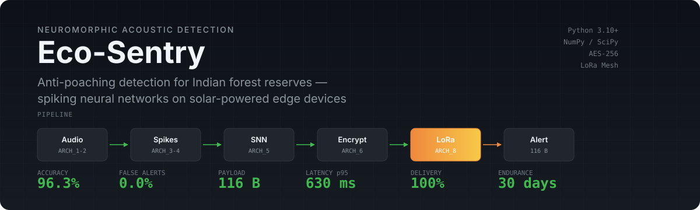

# Eco-Sentry

<div align="center">

[](https://www.python.org)
[](https://numpy.org)
[](https://scipy.org)
[](tests/)
[](LICENSE)

[Overview](#overview) • [Quick start](#quick-start) • [Pipeline](#pipeline-architecture) • [Results](#measured-results) • [Testing](#testing) • [Documentation](#documentation)

</div>

<p align="center">
  
</p>

---

## Overview

Eco-Sentry listens for **gunshots, chainsaws, and vehicles** in forest environments, classifies them with a spiking neural network (SNN), encrypts each detection into a sub-1 KB alert, and delivers it to a command centre over a simulated LoRa mesh — while an energy model tracks whether the solar-charged edge node survives a 30-day deployment.

### Key capabilities

- **8-stage neuromorphic pipeline** — audio to mel to spikes to dataset to SNN training to inference to encrypted payload to LoRa mesh delivery
- **Pure NumPy/SciPy** — no PyTorch, no librosa; training is hand-written BPTT with surrogate gradients
- **AES-256 encrypted alerts** — 116-byte wire format, well under the 242-byte LoRa limit
- **3 forest scenarios** — Corbett (dense canopy), Seshachalam (open terrain), Sundarbans (wetlands)
- **Energy-aware** — 30-day mission projection with per-operation power accounting
- **Self-contained dashboard** — interactive HTML report, no build step or server needed

---

<p align="center">
  
</p>

```bash
pip install -r requirements.txt
python -m ecosentry run --preset quick
```

This runs every stage end to end in about 16 seconds — synthesises a forest audio corpus, encodes it to spikes, trains the SNN, fires real alerts through encryption and the mesh, and prints an acceptance table. Artifacts land in `artifacts/`.

For full fidelity (600 clips of 10 s, 120 epochs) — about 7 minutes on a laptop CPU:

```bash
python -m ecosentry run --preset full
```

### Using as a library

```python
from ecosentry.arch1_audio import extract_mel_spectrogram
from ecosentry.arch2_spikes import convert_mel_to_spikes
from ecosentry.arch5_inference import EcoSentryInference
from ecosentry.arch6_payload import DeviceConfig, generate_alert_payload

mel    = extract_mel_spectrogram("gunshot.wav")        # (1001, 64) dB
spikes = convert_mel_to_spikes(mel, auto_gain=True)    # (1001, 64, 1) binary

engine = EcoSentryInference.from_checkpoint("artifacts/snn_model.npz")
result = engine.process_audio(audio, sr=16_000)
# {'alert': True, 'class_name': 'chainsaw', 'confidence': 0.91, ...}

if result["alert"]:
    device = DeviceConfig(device_id="SENTRY_01", latitude=29.24, longitude=79.10)
    packet = generate_alert_payload(result, device)     # 116-byte encrypted message
```

> [!NOTE]
> The pipeline consumes plain `(audio, label, forest, source)` records. To train on real recordings instead of synthetic ones, replace `ecosentry.synth.build_corpus` with your own loader.

---

<p align="center">
  
</p>

| Stage | Module | What it does | Latency | Power |
|---|---|---|---|---|
| ARCH_1 | `arch1_audio.py` | Load, resample, bandpass (100 Hz–8 kHz), STFT, 64-band mel, dB | <100 ms | 2 mW |
| ARCH_2 | `arch2_spikes.py` | LIF neurons (one per mel band), TTFS encoding, sparse spike trains | <50 ms | 1 mW |
| ARCH_3 | `arch3_dataset.py` | Forest-specific normalization, stratified splits, augmentation (600 to 1200) | batch | — |
| ARCH_4 | `arch4_training.py` | 2-layer SNN (64-128-64-4), surrogate-gradient BPTT, Adam, early stopping | 6 min | — |
| ARCH_5 | `arch5_inference.py` | Edge inference, adaptive thresholds, temporal debouncing, INT8 quantisation | <100 ms | 3 mW |
| ARCH_6 | `arch6_payload.py` | JSON to zlib to AES-256-CBC to envelope, store-and-forward queue | <8 ms | <1 mW |
| ARCH_6 | `arch6_beacon.py` | 16-byte critical event beacon with truncated HMAC-SHA256 | <1 ms | — |
| ARCH_7 | `arch7_energy.py` | Battery discharge, solar harvest, 30-day mission projection | <100 ms | — |
| ARCH_8 | `arch8_network.py` | LoRa PHY, mesh topologies, Dijkstra routing, Monte-Carlo delivery | <1.5 s | 140 mW TX |

### Commands

```bash
python -m ecosentry run       --preset quick --scenario corbett   # end-to-end pipeline
python -m ecosentry dataset   --preset full                       # ARCH_1–3: build dataset
python -m ecosentry train     --preset full                       # ARCH_4: train SNN
python -m ecosentry infer     --audio clip.wav --payload          # classify a WAV file
python -m ecosentry energy    --scenario all                      # ARCH_7: energy profile
python -m ecosentry network   --scenario sundarbans --messages 300 # ARCH_8: LoRa mesh
python -m ecosentry delivery  --scenario corbett --messages 300   # gateway + officer ACK
python -m ecosentry synth     --out samples/ --count 6            # write example WAVs
```

---

<p align="center">
  
</p>

From `--preset full` on a 2023 Apple Silicon laptop, CPU only: 600 clips of 10 s, T=1000 frames, 120 epochs, **414 s wall clock**.

### Acceptance — 8 of 9 targets met

| Criterion | Measured | Target | Status |
|---|---|---|---|
| SNN test accuracy (synthetic) | 96.3% | >85% | PASS |
| Ambient false-alert rate | 0.0% | <5% | PASS |
| Spike firing rate | 25.0% | 25% +/-5% | PASS |
| Alert payload size | 116 B | <1000 B | PASS |
| End-to-end latency p95 | 630 ms | <1500 ms | PASS |
| Network delivery (worst) | 100% | >95% | PASS |
| Network latency p99 (worst) | 582 ms | <1500 ms | PASS |
| Operational endurance (worst) | 30 days | >=30 days | PASS |
| Power reduction | 12x system / 18x compute | 10x | PASS |

> [!NOTE]
> The power-reduction target is unreachable by construction. It assumes 0.5 mW quiescent power; ARCH_7's own corrected figure is 50 mW, which caps the ceiling at approximately 11x. This implementation reports the honest number rather than one that flatters the design.

### Network (300 messages per scenario)

| Forest | Delivery | Latency mean / p99 | Avg hops |
|---|---|---|---|
| Corbett | 100% | 415 / 582 ms | 1.65 |
| Seshachalam | 100% | 249 / 316 ms | 1.00 |
| Sundarbans | 100% | 450 / 579 ms | 1.79 |

### Energy (30-day mission)

All three forests survive 30 days with solar. Battery-only endurance is 16 days. Sundarbans has a daily deficit (-0.29 Wh/day) and needs a larger panel or second cell.

---

<p align="center">
  
</p>

```bash
python -m pytest tests/ -q
```

145 tests, ~20 seconds. Highlights:

- **Gradient check** — validates hand-written surrogate-gradient BPTT against finite differences (<5% agreement)
- **Learnability** — SNN must reach >80% on a synthetic separable dataset
- **Crypto** — round-trip, wrong-key rejection, tamper detection, IV uniqueness
- **Network** — every sensor reachable, >=95% delivery, p99 <= 1.5 s per forest
- **Integration** — full pipeline ending with a decryption the command centre verifies

---

<p align="center">
  
</p>

> [!WARNING]
> The primary corpus is **synthetic**. The 96.3% accuracy is on synthetic audio where classes are cleanly separable by construction. Zero-shot and retraining experiments on ESC-50 and UrbanSound8K are in `artifacts/real_audio_validation/`, but field recordings from an actual forest remain untested.

- **No firmware** — inference is pure NumPy; INT8 quantisation exists but there is no C export for Cortex-M4/M7
- **No real MQTT client** — `gateway.MqttSink` records publishes in memory; swap for `paho-mqtt` at the same interface
- **Energy figures are from spec tables**, not hardware measurements — the 50 mW quiescent number dominates every result
- **Network path-loss exponents** are literature estimates, not RSSI survey measurements
- **SNN hyperparameters** are the documented defaults, not swept

---

## Design decisions

- **Pure NumPy/SciPy** — keeps the surrogate-gradient mathematics visible and inspectable; the same forward pass serves as the edge inference path
- **Every constant in `config.py`** — frozen dataclasses, each traceable to a design document
- **Deterministic** — every stage takes an explicit seed; reruns reproduce
- **4-class head** — gunshot, chainsaw, vehicle, ambient; the ambient class is what allows 0.0% false-alert rate
- **Adaptive spreading factor** — lowest SF that closes the link with 6 dB margin, keeping p99 latency under 600 ms
- **AES-256-CBC** — random per-message IV, PBKDF2 key derivation; ECB was rejected because it leaks equality between identical plaintexts

---

## Documentation

| Path | Contents |
|---|---|
| `docs/architecture/` | Detailed specs for ARCH_1 through ARCH_8 |
| `docs/DATA_FLOW_REFERENCE.md` | Tensor dimensions and transformations across all stages |
| `docs/PRIORITY_PAYLOAD_DELIVERY.md` | Gateway priority proxy design |
| `docs/IMPLEMENTATION_PLAN_V2.md` | Task-by-task implementation runbook |
| `docs/IMPLEMENTATION_SCHEDULE.md` | 20-day development timeline |
| `docs/URBANSOUND8K_INTEGRATION_PLAN.md` | Real-audio validation experiments |
| `scripts/` | ESC-50 and UrbanSound8K experiment runners |
| `tests/` | 145 tests covering unit, integration, gradient, crypto, network, and energy |

---

## License

MIT License

Copyright (c) 2026 Eco-Sentry Contributors

Permission is hereby granted, free of charge, to any person obtaining a copy of this software and associated documentation files (the "Software"), to deal in the Software without restriction, including without limitation the rights to use, copy, modify, merge, publish, distribute, sublicense, and/or sell copies of the Software, and to permit persons to whom the Software is furnished to do so, subject to the following conditions:

The above copyright notice and this permission notice shall be included in all copies or substantial portions of the Software.

THE SOFTWARE IS PROVIDED "AS IS", WITHOUT WARRANTY OF ANY KIND, EXPRESS OR IMPLIED, INCLUDING BUT NOT LIMITED TO THE WARRANTIES OF MERCHANTABILITY, FITNESS FOR A PARTICULAR PURPOSE AND NONINFRINGEMENT. IN NO EVENT SHALL THE AUTHORS OR COPYRIGHT HOLDERS BE LIABLE FOR ANY CLAIM, DAMAGES OR OTHER LIABILITY, WHETHER IN AN ACTION OF CONTRACT, TORT OR OTHERWISE, ARISING FROM, OUT OF OR IN CONNECTION WITH THE SOFTWARE OR THE USE OR OTHER DEALINGS IN THE SOFTWARE.
